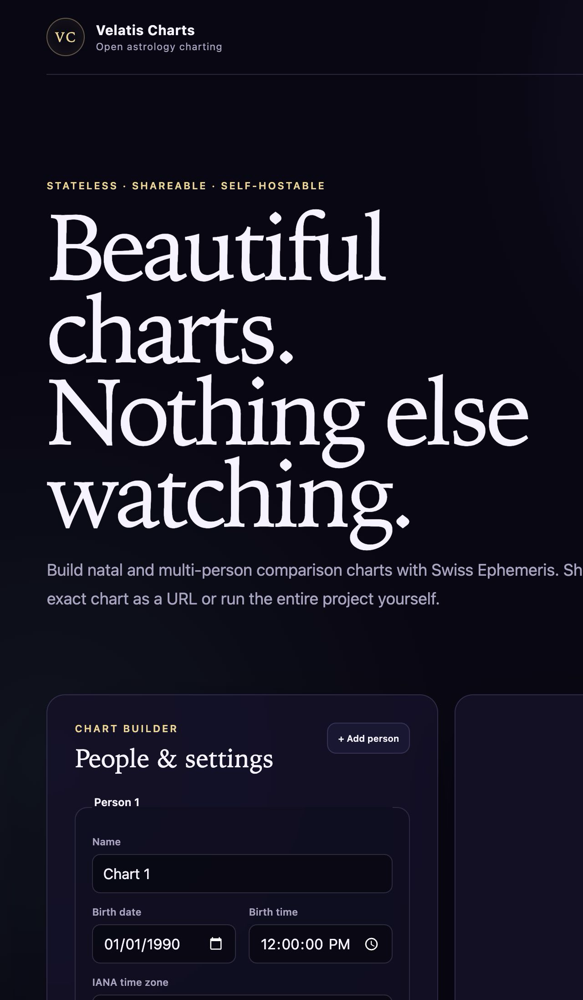
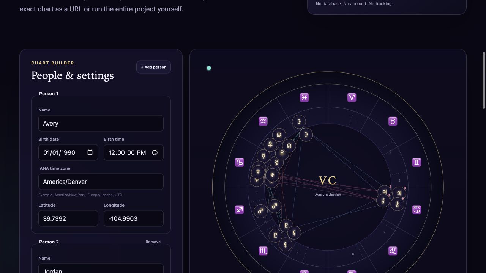
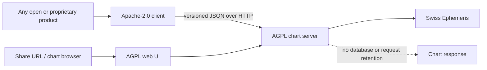

# Velatis Charts

[](https://github.com/Ravonus/velatis-charts/actions/workflows/ci.yml)
[](./LICENSE)
[](./packages/client/LICENSE)
[](./package.json)

Open-source, stateless astrology charting with deterministic share URLs.

Velatis Charts calculates and renders natal, comparison, and transit charts.
It deliberately has no database, accounts, chat, video, AI, billing,
advertising, analytics, or tracking. The complete versioned chart input travels
in the share URL, so operators do not need to retain birth data.

[Try the hosted chart builder](https://charts-api.velatis.io) ·
[Read the API](#http-api) · [Self-host](#self-hosting) ·
[Contribute](./CONTRIBUTING.md)

## See it





The screenshots are generated from the production build using synthetic birth
data. No personal information is committed to this repository.

## What it includes

- natal charts for one person;
- multi-person comparison charts and pairwise aspects;
- transit chart state;
- tropical and sidereal zodiac modes;
- ten house systems and selectable node/point/orb settings;
- an accessible SVG chart wheel plus a detailed data table;
- deterministic, versioned URL encoding;
- a typed JSON client and an open-ended ephemeris API;
- a one-command self-hosted server with the web interface bundled;
- no server-side persistence.

## Quick start

### Run the released server

```bash
pnpm --allow-build=swisseph-v2 dlx \
  https://github.com/Ravonus/velatis-charts/releases/download/v0.2.0/velatis-charts-server-0.2.0.tgz \
  serve
```

Open <http://127.0.0.1:4321>.

The explicit `--allow-build` permission grants only the native Swiss Ephemeris
binding permission to compile. Modern pnpm versions block dependency build
scripts by default; omitting it can create a server that starts but cannot
calculate.

When the registry package is published, the equivalent command is:

```bash
pnpm --allow-build=swisseph-v2 dlx @velatis/charts-server serve
```

### Run from source

Requirements: Node.js 22+, pnpm 10, and a C/C++ toolchain supported by
`node-gyp`.

```bash
git clone https://github.com/Ravonus/velatis-charts.git
cd velatis-charts
pnpm install --frozen-lockfile
pnpm check
pnpm charts
```

## Use it from another product

Applications import only the permissively licensed client:

```bash
pnpm add @velatis/charts-client
```

```ts
import {
  ChartsClient,
  buildShareUrl,
  createDefaultChartState,
} from "@velatis/charts-client";

const state = createDefaultChartState({
  name: "Avery",
  localDate: "1990-01-01",
  localTime: "12:00",
  timeZone: "America/Denver",
  latitude: 39.7392,
  longitude: -104.9903,
});

const charts = new ChartsClient({
  baseUrl: "https://charts-api.velatis.io",
});

const shareUrl = buildShareUrl(charts.baseUrl, state);
const result = await charts.calculate(state);

const positions = await charts.ephemeris("positions", {
  samples: [{ julianDay: 2_461_231, bodyIds: [0, 1] }],
});
```

The client communicates over HTTP with a separately operated
`@velatis/charts-server`. Do not import the AGPL server into a closed-source
program.

## Architecture



| Package                     | Purpose                                           | License           |
| --------------------------- | ------------------------------------------------- | ----------------- |
| `@velatis/charts-contracts` | Versioned data contract and extension model       | Apache-2.0        |
| `@velatis/charts-client`    | URL codec, API client, and embed helpers          | Apache-2.0        |
| `@velatis/charts-server`    | Swiss Ephemeris adapter, HTTP API, and bundled UI | AGPL-3.0-or-later |
| `@velatis/charts-web`       | Chart builder and SVG viewer                      | AGPL-3.0-or-later |

The boundary is intentional. The client and contracts contain no Swiss
Ephemeris code. See [LICENSING.md](./LICENSING.md) before redistributing or
combining packages.

## Stable public contract

The state contract begins at `version: 1` and supports:

- natal, multi-person comparison, and transit modes;
- tropical/sidereal settings, house systems, ayanamsas, nodes, points, and
  orbs;
- presentation hints that never change the calculation;
- reverse-DNS extensions such as `com.example.progressions`.

Experimental downstream workflows belong in namespaced extensions until they
are mature enough for the shared contract. Breaking chart-state changes require
a new decoder/migration path; existing share URLs must remain readable.

## HTTP API

### `POST /api/v1/charts`

Accepts a `ChartStateV1` body and returns `ChartResultV1`. Invalid inputs and
bodies over 256 kB are rejected.

### `POST /api/v1/ephemeris`

Accepts a versioned `{ operation, input }` envelope. Operations include chart
frames, batched positions, exact crossings, eclipse searches, rise/set
calculations, and fixed stars.

### `GET /api/v1/health`

Returns readiness, API version, statelessness, and the exact corresponding
source URL. Production monitors should also execute one small `positions`
request before declaring calculation readiness.

Every API response containing chart data is `Cache-Control: no-store`.

## Self-hosting

For a production container pinned to the immutable v0.2.0 artifact:

```bash
docker compose -f deploy/docker-compose.production.yml up -d --build --wait
```

The container binds only to host loopback on port 4321. Put an HTTPS reverse
proxy such as [`deploy/Caddyfile.example`](./deploy/Caddyfile.example) in front
of it.

Important environment settings:

| Variable                         | Purpose                                                     |
| -------------------------------- | ----------------------------------------------------------- |
| `VELATIS_CHARTS_SOURCE_URL`      | Exact public corresponding-source URL for the running build |
| `VELATIS_CHARTS_ALLOWED_ORIGINS` | Comma-separated browser origins allowed by CORS             |
| `HOST` / `PORT`                  | Server bind address and port                                |

Review [LICENSING.md](./LICENSING.md), [SECURITY.md](./SECURITY.md), and the
[release QA checklist](./docs/qa/release-checklist.md) before exposing a public
instance.

## Privacy model

Share URLs are portable, not encrypted. Anyone who receives a link can decode
its chart inputs. Do not put share URLs in analytics, support tickets, or access
logs. Configure reverse proxies and CDNs to omit query strings.

The calculation API uses POST plus `no-store`, so birth inputs do not need to
appear in an API URL. Operators are responsible for the behavior of their own
proxy, hosting, and observability stack.

## Quality system

`pnpm check` is the pull-request gate. It runs:

1. formatting and ESLint;
2. the quality-contract linter;
3. TypeScript;
4. unit tests with V8 coverage thresholds;
5. the production build;
6. executable Cucumber/Gherkin acceptance scenarios;
7. license-boundary compliance checks;
8. Stryker mutation testing.

See [QUALITY.md](./QUALITY.md) for thresholds, evidence, flaky-test policy, and
manual QA.

## Community

Issues and focused pull requests are welcome.

- [Contributing guide](./CONTRIBUTING.md)
- [Code of conduct](./CODE_OF_CONDUCT.md)
- [Governance](./GOVERNANCE.md)
- [Changelog](./CHANGELOG.md)
- [Support policy](./SUPPORT.md)
- [Security policy](./SECURITY.md)

`0.x` is the public foundation. APIs may receive additive improvements before
1.0, while versioned URLs remain backward-compatible.
